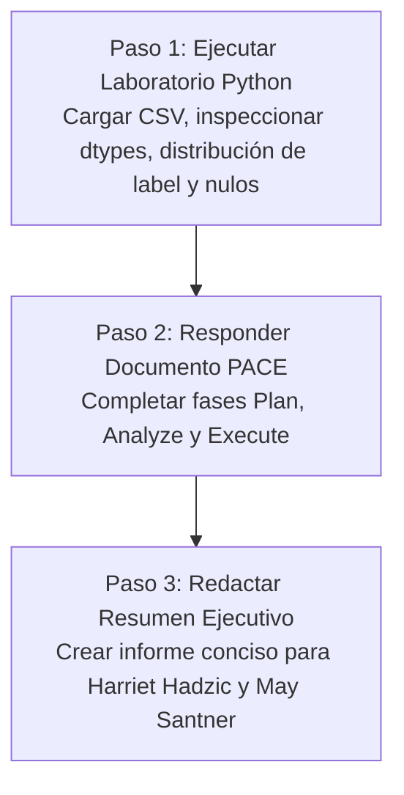

# Documento de Handoff: Proyecto Waze (Curso 1)

[⬅ Volver al README del Proyecto](README.md) | [Documento de Trabajo (waze.md)](waze.md) | [Propuesta de Hitos](Propuesta_del_Proyecto_Waze.md) | [Protocolo de Agentes (AGENTS.md)](AGENTS.md)

> [!IMPORTANT]
> **DIRECTIVA PARA EL AGENTE RECEPTOR:**
> Este documento contiene el estado operativo exacto, el contexto de negocio y el plan de ejecución paso a paso para desarrollar el proyecto **Waze** en el marco del **Curso 1: Foundations of Data Science** del Certificado de Google Advanced Data Analytics. El entorno está 100% configurado y listo para resolver las tareas del hito.

---

## 1. Contexto del Negocio y Misión del Proyecto

- **Socio de la Industria:** Waze.
- **Equipo:** Crecimiento y Retención de Conductores (*Growth & Driver Retention*).
- **Problema Comercial:** Waze depende de los reportes viales comunitarios en tiempo real para optimizar sus rutas. El abandono de usuarios (*churn*) perjudica la densidad de alertas y la experiencia general de navegación. Se requiere predecir qué usuarios están en riesgo de desinstalar o abandonar la app para activar campañas proactivas de retención.
- **Objetivo del Hito Actual (Curso 1):** Realizar la inspección y preparación preliminar de los datos en Python, responder al Documento de Estrategia PACE y elaborar un Resumen Ejecutivo para la directiva de Waze.

---

## 2. Mapa de Archivos del Proyecto

Todos los recursos se encuentran organizados localmente dentro de este directorio (`Advanced Data Analytics/proyectos/03_Waze_Project/`):

| Archivo | Función / Contenido | Estado |
| :--- | :--- | :---: |
| **`HANDOFF_WAZE.md`** | Este documento de transferencia y guía de ejecución. | `Completado (Curso 1)` |
| **`README.md`** | MOC del proyecto con enlaces de navegación a todos los artefactos. | `Completado` |
| **`AGENTS.md`** | Directivas operativas para agentes y autorización de lectura externa. | `Completado` |
| **`waze.md`** | Notas de contexto, equipo de trabajo, correos electrónicos y diccionario de 13 columnas. | `Formateado y listo` |
| **`Propuesta_del_Proyecto_Waze.md`** | Matriz oficial de hitos, entregables y partes interesadas para los 6 cursos. | `Completado` |
| **`PACE_Strategy_Document_Waze.md`** | Estrategia PACE completada en las fases Plan, Analyze y Execute. | `Completado` |
| **`Resumen_Ejecutivo_Waze_Curso1.md`** | Resumen Ejecutivo final para Harriet Hadzic, May Santner y el equipo directivo. | `Completado` |
| **`waze_dataset.csv`** | Conjunto de datos oficial de Waze (14.999 usuarios x 13 variables). | `Disponible localmente` |
| **`Activity_Course 2 Waze project lab.ipynb`** | Cuaderno oficial de Jupyter ejecutado y validado con outputs y respuestas. | `Completado y ejecutado` |
| **`images/`** | Diagramas de las fases PACE requeridos por el cuaderno de Jupyter. | `Disponible localmente` |
| **`../Plantilla_Resumen_Ejecutivo.md`** | Plantilla Markdown para redactar el informe ejecutivo final. | `Disponible` |
| **`../../01_Foundations_of_Data_Science/apuntes/`** | Notas conceptuales de los 5 módulos teóricos del Curso 1. | `Disponible para consulta` |

---

## 3. Plan de Ejecución Inmediato (Paso a Paso)

### Paso 1: Ejecución e Inspección en Python
1. Abrir el cuaderno de Jupyter: [`Activity_Course 2 Waze project lab.ipynb`](Activity_Course%202%20Waze%20project%20lab.ipynb).
2. Importar `pandas` y `numpy`.
3. Cargar el dataset local `waze_dataset.csv`.
4. Ejecutar las celdas de inspección técnica:
   - Dimensiones del DataFrame (`df.shape` - 14.999 filas x 13 columnas).
   - Resumen de tipos de datos (`df.dtypes`, `df.info()`).
   - Identificación de valores nulos o faltantes (`df.isna().sum()`) — atención a la columna `label`.
   - Estadísticas descriptivas (`df.describe()`).
   - **Análisis de la variable de abandono (`label`):** Proporción de usuarios retenidos (`retained`) vs abandonados (`churned`).
   - Comparación de hábitos de conducción: diferencias en `driven_km_drives`, `sessions` y `activity_days` según el sistema operativo (`device`: Android vs iPhone).
5. Responder a las preguntas reflexivas en las celdas de texto del cuaderno.

---

### Paso 2: Completar el Documento de Estrategia PACE
Abrir [`PACE_Strategy_Document_Waze.md`](PACE_Strategy_Document_Waze.md) y responder formalmente a cada pregunta:
- **Plan:** Planteamiento de las metas de retención, partes interesadas (Harriet Hadzic, May Santner, Chidi Ga, Sylvester Esperanza) y definición operativa de churn.
- **Analyze:** Análisis de la suficiencia del dataset, evaluación de nulos en la variable objetivo y rangos de actividad mensual.
- **Execute:** Recomendaciones estratégicas para la fase de EDA del Curso 2 (segmentación por nivel de uso, análisis de trayectos a favoritos `total_navigations_fav1/2`).

---

### Paso 3: Redactar el Resumen Ejecutivo
Crear `Resumen_Ejecutivo_Waze_Curso1.md` dentro de esta carpeta utilizando [`../Plantilla_Resumen_Ejecutivo.md`](../Plantilla_Resumen_Ejecutivo.md):
- **Visión General:** Misión de Waze y valor económico de prevenir el abandono de conductores.
- **Calidad de Datos:** Resumen cuantitativo de usuarios analizados y nulos detectados.
- **Conclusiones y Momento "¡Ajá!":** Hallazgos clave sobre la relación entre días de conducción y probabilidad de abandono.
- **Próximos Pasos para el Curso 2:** Hoja de ruta para el EDA profundo y visualizaciones en Tableau.

---

## 4. Reglas Obligatorias
- Enlaces relativos nativos de Obsidian (sin `file:///`).
- Código reproducible y claro en Python.
